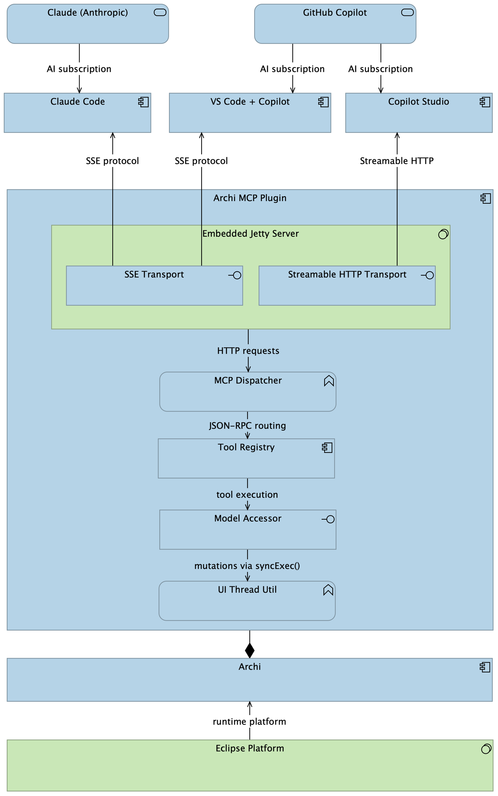

# Archi MCP Plugin

> **Status: Early Testing** — This plugin has been tested with Claude Code and GitHub Copilot in VS Code on macOS and Windows. It is functional but may have rough edges. Feedback, bug reports, and feature requests are very welcome — please open a [GitHub Issue](https://github.com/JesseLeresche/archi-mcp-server/issues).

An Eclipse OSGi plugin for [Archi](https://www.archimatetool.com/) that implements the [Model Context Protocol (MCP)](https://modelcontextprotocol.io/) over HTTP. Once installed, it starts an embedded MCP server on `localhost:7432` that lets any MCP-compliant AI assistant read and modify your open ArchiMate models in real time.

**No additional software required.** Unlike many MCP servers that require Node.js, Python, or a separate process to be running, this plugin is a single JAR that installs directly into Archi. Drop it in the `dropins/` folder, restart Archi, and it's ready — nothing else to install or configure.

## Architecture

> *This diagram was created, exported, and added to this README automatically by Claude Code using the Archi MCP Plugin.*



## Features

- **No extra dependencies** — single JAR bundles everything (Jetty 12 + Jackson); no Node.js, Python, or sidecar process needed
- **Multi-model support** — list all open models and switch between them
- **Query & filter** — search elements by type, layer, name, or custom property value
- **Full model authoring** — create elements, relationships, views, and folders, targeting a folder by ID or by path
- **Relationship guidance** — look up which relationship types are valid between two elements, and find relationships already connecting a pair, before creating one
- **Type change** — change an element's ArchiMate type while preserving all relationships and view references
- **Visual layout** — place elements on views (including inside groups), draw connections, set positions and sizes
- **Connection label positioning** — set a connection's label to sit at the source end, middle, or target end, at creation time or after
- **Appearance control** — change fill color, font color, line color, opacity, and line width
- **Figure repositioning** — move and resize existing figures on a view by setting `x`/`y`/`width`/`height` via `manage_appearance`
- **Property management** — set, update, and remove names, documentation, and custom key/value properties
- **Folder browsing** — get folder tree hierarchy, list folder contents (elements, relationships, views)
- **Folder management** — create folders and move elements, relationships, and views between folders
- **View management** — duplicate views with all figures, groups, notes, and connections; remove figures from views
- **View layout** — query figure positions and sizes on any view, including nested and grouped elements
- **Groups & notes** — full support for visual grouping elements and notes on views
- **Connection inspection** — get connection details including bendpoints, colors, and line width
- **Connection management** — update or delete visual connections on views
- **Relationship attributes** — set access type by name (Write, Read, Unspecified, ReadWrite), Influence strength and Association direction
- **Relationship query** — list every relationship in the model, drawn or not, with full replayable detail
- **Bulk operations** — create, update, or move multiple elements, relationships, or views in a single call
- **Relationship editing** — change a logical relationship's type (preserving its ID and view connections) or delete it without touching endpoints, with bulk variants for spec-compliance sweeps
- **Bulk type change** — change the ArchiMate type of multiple elements in one call, preserving all references
- **Bulk view creation** — create multiple views in a single call
- **Bulk figure styling** — update appearance of multiple figures across views in one call
- **View editing** — update a view's name and documentation after creation
- **Connection inspection** — list all connections on a view with routing, bendpoints, and access types
- **BIAN SD Overview composite** — create a complete BIAN Service Domain Overview view (elements, relationships, figures, connections, styling) in one atomic call
- **Bulk BIAN SD Overview** — create many SD Overview views in a single call with shared folder defaults and per-item success/error results
- **Element analysis** — inspect an element's relationships and view usage
- **Token-efficient responses** — minimal JSON responses (no echoed inputs, no success flags, no derivable counts) to reduce LLM token usage by ~35-40%
- **View export** — export any view as a PNG image, returned inline via MCP and optionally saved to disk
- **Auto-layout** — hierarchical directed graph layout for views, with recursive nested container support and automatic container resizing
- **Model validation** — validate all relationships against the ArchiMate specification, with inline validation on relationship creation
- **Undo support** — all mutation tools integrate with Eclipse's CommandStack, enabling Ctrl+Z undo in Archi for MCP-driven changes
- **MCP image content** — tools can return image content blocks natively, enabling visual feedback to AI agents
- **MCP Resources (agent guides)** — bundled Markdown design guides for standard view types (layered, application structure, data model, infrastructure), discoverable via `resources/list` and fetched with `resources/read`
- **Dual MCP transport** — SSE (Claude Code, VS Code Copilot) and Streamable HTTP (Copilot Studio)

## Tested With

| Client | Platform | Status |
|--------|----------|--------|
| [Claude Code](https://claude.ai/code) | macOS, Windows | Tested |
| GitHub Copilot (VS Code) | macOS, Windows | Tested |
| Copilot Studio | — | Untested — feedback welcome |

## Supported Clients

| Client | Transport |
|--------|-----------|
| [Claude Code](https://claude.ai/code) | SSE |
| GitHub Copilot (VS Code) | SSE |
| Copilot Studio | Streamable HTTP |

---

## Installation

### Option A — Use the pre-built release (recommended)

1. Download the latest JAR from the [Releases page](https://github.com/JesseLeresche/archi-mcp-server/releases).

2. Copy it into Archi's `dropins/` directory:

   **macOS**
   ```bash
   cp za.co.jesseleresche.archi.mcp-3.0.0.jar /Applications/Archi.app/Contents/Eclipse/dropins/
   ```

   **Linux**
   ```bash
   cp za.co.jesseleresche.archi.mcp-3.0.0.jar /opt/Archi/dropins/
   ```

   **Windows** (PowerShell)
   ```powershell
   Copy-Item za.co.jesseleresche.archi.mcp-3.0.0.jar "C:\Program Files\Archi\dropins\"
   ```

   > **Upgrading from an earlier version?** Delete any existing
   > `za.co.jesseleresche.archi.mcp-*.jar` from `dropins/` **before** copying the new one.
   > The plugin is a singleton OSGi bundle — if multiple versions are present, Archi may load
   > an old one and your upgrade won't take effect. Only `za.co.jesseleresche.archi.mcp-3.0.0.jar`
   > should remain. For example, on macOS:
   > ```bash
   > rm /Applications/Archi.app/Contents/Eclipse/dropins/za.co.jesseleresche.archi.mcp-*.jar
   > cp za.co.jesseleresche.archi.mcp-3.0.0.jar /Applications/Archi.app/Contents/Eclipse/dropins/
   > ```

3. Restart Archi. The MCP server starts automatically.

4. Verify it's running:
   ```bash
   curl http://localhost:7432/health
   ```

### Option B — Build from source

See [Building Locally](#building-locally) below.

---

## Configuration for AI Clients

### Claude Code

Add to your project's `.mcp.json`, or to `~/.claude/claude_code_config.json` for global access:

```json
{
  "mcpServers": {
    "archi": {
      "type": "sse",
      "url": "http://localhost:7432/sse"
    }
  }
}
```

Restart Claude Code (or run `/mcp` to reload servers). Archi tools will appear automatically once a model is open in Archi.

### GitHub Copilot in VS Code

1. Open **Settings** (`Cmd+,` / `Ctrl+,`) and search for `mcp`.
2. Click **Edit in settings.json** under `github.copilot.chat.mcp.servers`.
3. Add the following entry:

```json
{
  "github.copilot.chat.mcp.servers": {
    "archi": {
      "type": "sse",
      "url": "http://localhost:7432/sse"
    }
  }
}
```

4. Reload VS Code. The Archi tools will be available in Copilot Chat when Agent mode is active (`@workspace` or `#tools`).

### Copilot Studio / Streamable HTTP

Use `POST http://localhost:7432/mcp` as the single-endpoint Streamable HTTP connector.

Since v3.0.0 the MCP endpoints reject requests whose `Host` (or `Origin`, when sent) isn't
`localhost`, `127.0.0.1` or `[::1]`. If you reach Archi through a tunnel or reverse proxy that
forwards its own host name, allow it with `-Darchi.mcp.allowed.hosts=<host>`.

---

## Available Tools

As of **v2.0.0** the tools are consolidated by domain entity. Each `manage_*` tool takes an
`operation` discriminator plus an `items` payload that accepts **either a single object or an
array** (batch) — a single object is treated as a one-item batch. Write tools return a uniform
`{ "results": [ … ] }` with a per-item success or error entry. This replaces the former
~45 single/`bulk_*` tools and dramatically shrinks the `tools/list` payload.

> **Migration from v1.x:** the old per-operation tool names (`create_element`, `bulk_create_elements`,
> `add_element_to_view`, `delete_view`, …) were removed. Use the consolidated tools below — e.g.
> `create_element` → `manage_elements` with `operation: "create"`; `bulk_add_elements_to_view`
> → `manage_view_content` with `operation: "add_figure"`.
>
> **Migration to v3.0.0 (breaking):** four operations were renamed so figures and connections pair
> up by noun — `set_figure` → `set_style`, `add_element` → `add_figure`, `add_relationship` →
> `add_connection`, `delete_connection` → `remove_connection`. The old names return an error that
> names the replacement. `manage_relationships update` now *merges* `properties` (like elements)
> instead of replacing the whole list.

**Batch options (every `manage_*` tool):** `items` may be replaced by `items_file`, a bare `.json`
file name in the exchange folder `~/.archi-mcp/exchange` (override with
`-Darchi.mcp.exchange.dir=<dir>`; paths and symlinks are rejected). `results: "summary"` returns
`{count, succeeded, failed, errors: [{index, error}]}` instead of one entry per item.

**Caller-supplied IDs:** `create` on elements, relationships and views accepts `id`;
`add_figure` accepts `figure_id`, `add_connection` accepts `connection_id`. An ID already in the
model is an item error, or `{skipped: true}` with `on_conflict: "skip"`.

**Style vocabulary** (shared by `set_style`, `add_figure`, `add_connection`, `update_connection`
and `inspect_view definition`; absent = unchanged, `null`/`""` = reset to Archi's default):
`fill_color`, `line_color`, `font_color`, `icon_color`, `font` (Archi's platform-specific font string, e.g. `1|Arial|9.0|0|COCOA|1|ArialMT` — copy it from a `definition` rather than composing it), `opacity`, `line_opacity`,
`line_width`, `line_style`, `text_alignment`, `text_position`, `gradient`, `derive_line_color`,
`icon_visible`, `figure_type`, `border_type`, `image_source`, `image_path`, `image_position`,
`hide_junction_arrows`, `name_visible`, `label_expression`. A field that doesn't apply to the
target (e.g. `border_type` on an element figure) is an item error.

### Model session & querying

| Tool | Description |
|------|-------------|
| `manage_models` | `operation: list \| select` — list open models, or switch the active model by name/ID |
| `query_model` | Filter elements by ArchiMate type, layer, name, folder, `specialization`, or custom property (`property_key`/`property_value`/`property_value_prefix`); `include_properties` returns each element's custom properties |
| `get_views` | List diagram views with element, group, and note counts; `include_properties` returns each view's properties |

### Authoring & editing (write)

| Tool | Operations | Description |
|------|-----------|-------------|
| `manage_elements` | `create / update / delete / merge` | Element CRUD. `create` and `update` accept `properties` and `specialization`; `update` removes a property via a `null` value or `remove_properties: [key,...]`. `create` accepts `id` + `on_conflict`. Update supports type changes (`new_type`); delete removes every figure of the element plus every attached connection, and supports `dry_run`. `create` accepts `folder_path` as an alternative to `folder_id`. `merge` (`survivor_id`, `duplicate_ids`, `collapse?`, `resolve?`, `dry_run?`) folds same-type duplicates into the survivor, re-pointing relationships and retargeting figures in place; conflicting values come back as a diff to settle with `resolve` |
| `manage_relationships` | `create / update / delete / valid_types / between / query` | Relationship CRUD, plus read-only lookups: `valid_types` returns which relationship types the ArchiMate spec allows between a source/target pair, `between` finds existing relationships already connecting a pair, `query` lists every relationship in the model (drawn or not; filters `element_id`, `type_filter`, `on_view`, `model`, `output_file`) in `create`'s field names, so its output replays into `create`. Type changes preserve ID and view connections and report values the new type can't hold under `dropped`; delete supports `dry_run`; `create` accepts `id` + `on_conflict`, `documentation`, `properties`, `specialization` and `folder_path` as an alternative to `folder_id`, and fails on a same-type duplicate between the same ends unless `on_existing` is `reuse` or `add`; `access_type` is `Write` / `Read` / `Unspecified` / `ReadWrite` (or 0=Write, 1=Read, 2=Unspecified, 3=ReadWrite; default Write), `influence_strength` and `directed` set Influence strength and Association direction; `update` merges `properties` and sets `specialization`; `between` accepts `include_properties` |
| `manage_views` | `create / update / delete / duplicate` | View management, including cloning a view with all figures/connections. `delete` reports the removed view's name and figure/connection counts; `create` accepts `id`, `properties` and `folder_path` as an alternative to `folder_id`; `update` accepts `properties` |
| `manage_view_content` | `add_figure / remove_figure / add_connection / update_connection / remove_connection` | Place/remove figures and draw/edit connections on a view (`view_id` given once at top level). `add_figure` adds element figures, groups or notes (`kind`), nested via `parent_figure_id` (which may name a figure added earlier in the same batch), styled at creation. `remove_figure` also removes the figure's nested figures and every attached connection. `remove_connection` removes only the drawing — delete the relationship with `manage_relationships delete` |
| `manage_folders` | `create / delete / move_element / move_view / list_contents / tree` | Create or delete folders (delete requires the folder to be empty), move elements/relationships/views, and inspect the folder hierarchy |
| `manage_appearance` | `set_style / layout_view` | Style figures or connections with the full style vocabulary (target by `figure_id`, `element_id`, `connection_id` or `relationship_id`), reposition/resize figures (`x`/`y`/`width`/`height`), or auto-layout a view. `set_style` accepts a top-level `view_id` applied to items that omit their own |

### Inspection & analysis (read)

| Tool | Description |
|------|-------------|
| `inspect_view` | `operation: layout \| connections \| get_connection \| definition` — figure positions/sizes, connections on a view, one connection's visual properties, or a full replayable definition (`model` to read another open model, `output_file` to write it to the exchange folder) |
| `get_element_analysis` | Inspect an element's relationships, view usage (including each figure's geometry and colors), and properties |
| `validate_model` | Validate all relationships against the ArchiMate specification, reporting violations with valid alternatives. Always lists `dangling_connections` (ghost connections with a missing, detached or other-view end), each removable with `remove_connection` by `connection_id`. Optional convention checks: `require_properties`, `check_orphans`, `property_vocabularies` |

### Export & composite

| Tool | Description |
|------|-------------|
| `export_view_as_image` | Export a view as a PNG image, optionally saved to disk. Returns the image inline by default; set `inline: false` (or just set `output_path`) to skip returning the bytes |
| `create_sd_overview_view` | Create a complete BIAN SD Overview view with all elements, relationships, figures, connections, and styling in one atomic call |

---

## MCP Resources (Agent Guides)

In addition to tools, the plugin exposes MCP **Resources** — bundled Markdown design guides that
walk an AI agent through building a specific *kind* of ArchiMate view correctly: which element
types to use, which relationships are valid and in which direction, how to nest and style figures,
and the exact tool-call sequence to follow. Clients discover them with `resources/list` and fetch
their content with `resources/read`; `manage_views`' tool description tells agents which guide to
fetch before creating each of the view types below.

| URI | Guide |
|-----|-------|
| `archi://guides/layered-view` | Layered View — full stack, layer-by-layer (external actors → business → application → technology) |
| `archi://guides/application-structure-view` | Application Structure View — decomposing a composite Application Component into sub-components |
| `archi://guides/data-model-view` | Data Model View — a logical data store modeled as nested Data Objects |
| `archi://guides/infrastructure-view` | Infrastructure View — a Node's System Software/Device composition and what it realizes |

Want to add a guide for another view type? See [Adding a new view type
guide](CONTRIBUTING.md#adding-a-new-view-type-guide) in CONTRIBUTING.md, and start from
[`docs/view-guide-template.md`](docs/view-guide-template.md).

---

## HTTP Endpoints

| Endpoint | Method | Purpose |
|----------|--------|---------|
| `/sse` | GET | SSE transport — establishes event stream |
| `/message` | POST | SSE transport — sends JSON-RPC messages |
| `/mcp` | POST | Streamable HTTP transport |
| `/health` | GET | Health check and server info |
| `/openapi.yaml` | GET | OpenAPI specification |

---

## Configuration

| Property | Default | Description |
|----------|---------|-------------|
| `archi.mcp.port` | `7432` | HTTP port. Override with `-Darchi.mcp.port=<port>` JVM arg |
| Bind address | `127.0.0.1` | Loopback only — not configurable |
| `archi.mcp.allowed.hosts` | _(none)_ | Extra `Host`/`Origin` host names accepted besides localhost, comma-separated (e.g. a tunnel) |
| `archi.mcp.exchange.dir` | `~/.archi-mcp/exchange` | Folder for `items_file` / `output_file` |
| MCP version | `2024-11-05` | Protocol version advertised to clients |

To set a custom port, add the JVM argument in Archi's `Archi.ini`:
```
-Darchi.mcp.port=8080
```

---

## Building Locally

### Prerequisites

- [Archi 5.3.0+](https://www.archimatetool.com/download/) installed locally
- JDK 21+ (`JAVA_HOME` must point to it)
- Maven 3.9+

### 1. Configure the Archi path

Edit `target-platform/archi-mcp.target` and update the `<location path="...">` to your Archi installation:

| OS | Default path |
|----|-------------|
| macOS | `/Applications/Archi.app/Contents/Eclipse` |
| Linux | `/opt/Archi` |
| Windows | `C:\Program Files\Archi` |

Or pass it on the command line with `-Darchi.dir=<path>` (requires the profile-based setup described in the target file comments).

### 2. Build

```bash
# macOS / Linux
JAVA_HOME="$(/usr/libexec/java_home -v 21)" mvn clean verify

# Windows
set JAVA_HOME=C:\path\to\jdk-21
mvn clean verify
```

The plugin JAR is produced at:
```
za.co.jesseleresche.archi.mcp/target/za.co.jesseleresche.archi.mcp-3.0.0.jar
```

Jetty and Jackson JARs are downloaded automatically into `lib/` during the build.

### 3. Install

Copy the built JAR to Archi's `dropins/` directory (see [Installation](#installation) above) and restart Archi.

---

## Contributing

Contributions are welcome. Please read [CONTRIBUTING.md](CONTRIBUTING.md) for the full workflow.

In short:
1. Fork the repo and create a feature branch from `main`
2. Make your change and verify the build passes
3. Open a pull request with a clear description of what changed and why

---

## License

[MIT License](LICENSE) — Copyright (c) 2025 Jesse Leresche
